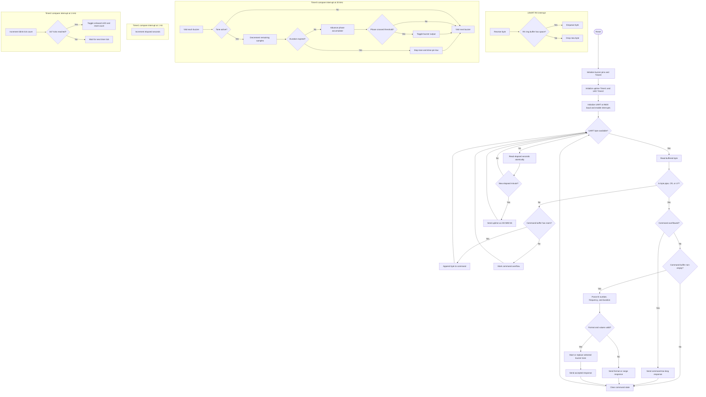

# AVR UART Buzzer Controller

Bare-metal C firmware for an Arduino Uno (ATmega328P, 16 MHz). It receives
commands over UART, drives three passive buzzers, blinks the onboard LED as a
health signal, and periodically reports uptime.

## Hardware

| Function | Uno pin | AVR pin |
| --- | --- | --- |
| Buzzer 1 | D8 | PB0 |
| Buzzer 2 | D9 | PB1 |
| Buzzer 3 | D10 | PB2 |
| Health LED | D13 | PB5 |
| UART RX/TX | D0/D1 | PD0/PD1 |

Use passive buzzers to reproduce the requested frequencies. Check the buzzer's
current requirements and use a transistor driver when needed; do not exceed the
ATmega328P GPIO current limits. A suitable series resistor may be needed for
piezo elements.

## UART Commands

UART is configured for 9600 baud, 8 data bits, no parity, and one stop bit
(8-N-1). Send a command terminated by `|`, carriage return, or line feed:

```text
B1_300_3
```

This plays buzzer 1 at 300 Hz for 3 seconds. The command fields are:

```text
B<buzzer number>_<frequency Hz>_<duration seconds>
```

For example, send several commands in one transmission with pipes between
them:

```text
B1_300_3|B2_440_3|B3_600_3|
```

The commands start as they are parsed, so their start times are close together
but are not synchronized to the same timer tick. Commands for a buzzer that is
already playing replace that buzzer's current tone. Accepted and invalid
commands receive a status message over UART.

## Implementation

- `src/uart.c` configures USART0 registers and receives bytes in the
  `USART_RX_vect` interrupt into a 64-byte ring buffer. One slot distinguishes
  full from empty, leaving 63 usable bytes. When full, new bytes are dropped.
  Formatted output is transmitted synchronously and its formatting buffer is
  limited to 95 characters plus the terminating null byte.
- `src/main.c` assembles UART bytes into commands and dispatches each command
  at a delimiter. The main loop also checks uptime and emits a heartbeat once
  per minute in `HH:MM:SS` format.
- `src/timer.c` owns Timer1 and Timer2 setup and their interrupt handlers.
  Timer1 tracks uptime; Timer2 blinks the onboard LED. `include/timer.h`
  exposes timer initialization and an atomic uptime getter to the main loop.
- `src/buzzer.c` stores each buzzer's pin and behavior in a `Buzzer` struct
  with play, stop, and tick function pointers. A shared Timer0 compare
  interrupt runs at 20 kHz and advances all active buzzers independently with
  a phase accumulator. Each output is a square wave, and each tone stops when
  its requested duration expires.
  that toggles the onboard LED every 167 ticks, for about three complete
  on/off cycles per second. The LED blink runs in an interrupt and does not
  block UART command processing.

## Flowchart

The main loop runs independently from the interrupt handlers. The handlers
continue receiving UART bytes, updating uptime, blinking the LED, and generating
active buzzer tones while the main loop parses commands.



## Current Limits

- Buzzer numbers are 1 through 3; frequency must be 1 through 9999 Hz, and
  duration must be 1 through 65535 seconds.
- The UART command assembly buffer holds up to 23 characters before its
  delimiter. The RX ring buffer can queue 63 bytes while the main loop is busy;
  excess incoming bytes are discarded.
- Timer0, Timer1, and Timer2 are all in use. Timer0's 20 kHz interrupt is the
  tone-generation time base; adding substantial work to that interrupt could
  affect timing accuracy.
- The two-digit hour field in the uptime heartbeat wraps after 99 hours.
- There is no UART command to stop a tone early; tones stop at their requested
  duration or when replaced by a new command for the same buzzer.

## Build and Upload

The project uses PlatformIO's Atmel AVR platform and does not use the Arduino
framework:

```text
platformio run
platformio run --target upload
```